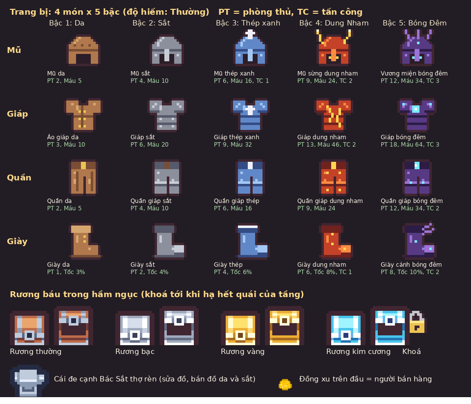

# Fantasy: The Awakening (bản chơi thử)

Game nhập vai hành động 2D pixel, góc nhìn từ trên xuống, làm bằng **Godot 4.7** (bản Standard, GDScript).

Một chiến binh thức tỉnh trong thế giới bị các thế lực cổ đại xâm chiếm. Bắt đầu yếu ớt, bạn đánh quái, lên cấp, thức tỉnh nguyên tố **Lửa** rồi **Sấm**, hạ Boss để mở cổng sang vùng đất mới.

## Video giới thiệu


Video demo dài khoảng 1 phút 34 giây, gồm 8 phần nối liền nhau: **Tạo nhân vật**, **Làng và cửa hàng**, **Kiếm Sĩ**,
**Xạ Thủ**, **Thương Thủ**, **Hầm Ngục Cổ**, **Rương báu** và **Boss Malakar**.
Bản video MP4 (nét hơn, nhẹ hơn, tua được): [doc/videos/demo.mp4](doc/videos/demo.mp4).

Các cảnh được quay từ game thật bằng chế độ demo tự chơi (`scripts/demo.gd`), lệnh: `godot --path . --write-movie _video/<cảnh>.avi --fixed-fps 30 -- --demo=<cảnh>`,
rồi ghép lại thành một video dài có tấm tiêu đề cho từng phần.

## Cách mở game

1. Mở `Godot_v4.7.2-stable_win64.exe`.
2. Trong cửa sổ **Project Manager**, bấm **Import**.
3. Chọn file `project.godot` trong thư mục này (ví dụ `E:\DEV\projects\game\project.godot`), rồi bấm **Import** (hoặc **Import & Edit**).
4. Lần đầu mở, Godot sẽ mất vài giây để nạp hình ảnh. Đợi xong rồi bấm **F5** (hoặc nút ▶ góc trên bên phải) để chơi.
5. Game mở ra ở **màn hình chọn tài khoản**. Bấm **Chơi** ở một tài khoản để chơi tiếp, hoặc bấm **Tạo tài khoản mới**
   để tạo nhân vật (đặt tên, chọn vũ khí và ngoại hình, rồi bấm **Bắt đầu phiêu lưu** hoặc Enter ở ô tên).

## Tài khoản và lưu game

Mỗi nhân vật là một **tài khoản** riêng. Game **tự lưu**: cấp, kinh nghiệm, vàng, túi đồ, trang bị (cả độ hiếm, độ bền),
thứ tự kỹ năng, chỗ đang đứng (kể cả đang ở tầng mấy của hầm ngục), cửa hang đã mở chưa, bếp lửa đã đặt.
Lần sau mở game chỉ cần bấm **Chơi** là vào lại đúng chỗ cũ, không phải tạo lại nhân vật.

- Game lưu mỗi **30 giây**, khi **lên cấp**, khi bấm **Esc** (tạm dừng), khi bấm **N** và khi tắt cửa sổ game.
  Mỗi lần lưu, góc dưới bên phải hiện chữ "Đã lưu game".
- Gục ngã thì bấm **R** để chơi tiếp từ lần lưu gần nhất. Bấm **N** (lúc tạm dừng, thua hoặc thắng) để về màn hình chọn tài khoản.
- Quái, cây, rương mỗi lần vào game lại mới. Rương hầm ngục khoá lại cho tới khi dọn sạch tầng lần nữa.
- **Đổi tên** nhân vật: bấm "Đổi tên", gõ tên mới (tối đa 14 chữ) rồi Enter. Esc để thôi.
- **Xóa** tài khoản: bấm "Xóa" rồi bấm "Chắc chắn?" trong 3 giây. Xóa rồi thì không lấy lại được.

**Tài Khoản Full** (viền vàng, chữ FULL) được tạo sẵn để thử mọi tính năng: Kiếm Sĩ **cấp 999** (cấp tối đa),
mở hết kỹ năng Q W E R và phím D, mặc đủ bộ trang bị **Thần thánh** bậc 5 (kể cả Kiếm bóng đêm), 999.999 vàng,
túi đồ 20 ô có sẵn thuốc, đồ ăn, rìu, liềm, đuốc, bộ lửa trại, nguyên liệu, và **cửa hang đã mở** để vào thẳng Hầm Ngục Cổ.
Lỡ xóa thì bấm **Thêm tài khoản Full** ở màn hình chọn tài khoản để tạo lại.

File lưu nằm trong thư mục dữ liệu của game: trong Godot chọn **Project > Open User Data Folder**, mở thư mục `tai_khoan`
(mỗi tài khoản một file `.cfg`). Muốn chỉnh tài khoản Full (cấp, vàng, đồ trong túi): sửa phần đầu `scripts/accounts.gd`.
Muốn đổi thời gian tự lưu: `AUTOSAVE_SECONDS` trong `scripts/main.gd`.

### Đăng nhập Google (lưu tài khoản lên mạng)

Nút **Đăng nhập Google** ở góc trên bên phải màn hình chọn tài khoản. Đăng nhập rồi thì mỗi lần game tự lưu, nhân vật cũng được
gửi lên mạng (Firebase của Google). Sang máy khác đăng nhập cùng Gmail là có lại đủ nhân vật. Không đăng nhập thì vẫn lưu trong máy như cũ.

Lần đầu cần tự tạo một project Firebase miễn phí rồi điền 4 dòng đầu file `scripts/cloud.gd`.
Làm theo từng bước trong **[doc/dang_nhap_google.md](doc/dang_nhap_google.md)** (khoảng 15 phút).

## Tạo nhân vật

Mỗi nhân vật chọn **1 trong 4 loại vũ khí** ngay lúc tạo. Vũ khí gắn liền với nhân vật đó và **không đổi được khi đang chơi**.
Sau này mỗi loại sẽ có cây kỹ năng riêng (có thể thêm nguyên tố).

| Vũ khí | Lớp nhân vật | Đặc điểm |
|---|---|---|
| Kiếm | Kiếm Sĩ | Đánh rất nhanh, bấm liên tục ra combo 3 đòn. Bị giáp chặn bớt sát thương. |
| Thương | Thương Thủ | Đâm xa, chậm hơn. Xuyên giáp và **phá giáp** quái. |
| Cung | Xạ Thủ | Bắn xa. **Giữ** nút đánh để gồng (có thanh dưới chân), thả ra bắn mũi tên đau gấp 3, xuyên qua 2 quái. |
| Sách Phép | Pháp Sư | Sách bay cạnh người, bắn tia phép. Sức mạnh nguyên tố sẽ thức tỉnh ở bản sau. |

Ngoại hình chọn được: màu da, kiểu tóc, màu tóc, trang phục, màu áo, mũ. Nút **Ngẫu nhiên** chọn bừa hết cho vui.
Nhân vật luôn cầm vũ khí đã chọn trên tay. Bấm **Bắt đầu phiêu lưu** là tạo một tài khoản mới cho nhân vật đó (xem phần "Tài khoản và lưu game").
Muốn tạo nhân vật khác: bấm **Esc** rồi **N** để về màn hình chọn tài khoản, rồi bấm **Tạo tài khoản mới**.

## Giáp của quái

Quái có giáp (biểu tượng khiên trên đầu, số giáp hiện ở thanh máu Boss) bị trừ bớt sát thương mỗi đòn.
Thương xuyên phần lớn giáp và mỗi đòn trúng làm giáp giảm đi 2 ("Phá giáp!"). Cung thủ xương có 3 giáp, Boss có 5, quái tinh anh thêm 2.

## Cấp của quái

Mỗi con quái có **cấp** (chữ **Lv** ngay trên thanh máu, Boss thì ghi cấp cạnh tên trên thanh máu lớn).
Cấp càng cao thì quái càng nhiều máu, đánh càng đau, nhưng cho nhiều kinh nghiệm và vàng hơn.
Mỗi cấp quái thêm khoảng 8% máu, 6% sát thương, 7% kinh nghiệm (cộng dồn), nên quái cấp 10 trâu gấp đôi quái cấp 1.

| Khu vực | Cấp quái |
|---|---|
| Rừng Hoang | 1 - 4 |
| Rừng Thông | 4 - 7 |
| Đầm Lầy Nấm | 6 - 9 |
| Boss Gorrak (Đấu Trường Đá Cổ) | 10 |
| Hầm ngục tầng 1 | 10 - 12 |
| Hầm ngục tầng 2 | 13 - 15 |
| Hầm ngục tầng 3 | 16 - 19 |
| Hầm ngục tầng 4 | 20 - 23 |
| Hầm ngục tầng 5 | Boss Malakar cấp 30 (cung thủ hắn gọi ra cấp 26) |

Màu chữ Lv so với cấp của bạn:

| Màu | Nghĩa |
|---|---|
| Xám | Quái yếu hơn bạn 5 cấp trở lên |
| Xanh lá | Quái yếu hơn bạn 2 đến 4 cấp |
| Trắng | Ngang sức (chênh 1 cấp) |
| Cam | Quái mạnh hơn bạn 2 đến 4 cấp, cẩn thận |
| Đỏ | Quái mạnh hơn bạn 5 cấp trở lên, rất nguy hiểm |

Quái do Boss gọi ra thấp cấp hơn Boss (slime của Gorrak thấp hơn 2 cấp, cung thủ của Malakar thấp hơn 4 cấp). Bù nhìn tập đánh không có cấp.

Muốn chỉnh: cấp quái ngoài trời là `enemy_level` của từng khu trong `AREAS` (đầu file `scripts/level.gd`), cấp Boss là
`BOSS_LEVELS` cũng trong file đó, cấp quái hầm ngục là `level` của từng tầng trong `scripts/dungeon.gd`.
Mỗi cấp tăng bao nhiêu: `HP_PER_LEVEL`, `DAMAGE_PER_LEVEL`, `XP_PER_LEVEL`, `GOLD_PER_LEVEL` ở đầu `scripts/enemies/enemy.gd`.

Nếu có lỗi, xem tab **Output** / **Debugger** ở dưới cùng của Godot.

## Điều khiển (chuột kiểu Liên Minh Huyền Thoại / Dota)

| Hành động | Phím |
|---|---|
| Đi tới chỗ bấm (tự tìm đường vòng qua cây, nhà, tường) | Chuột phải (giữ chuột phải để đi theo con trỏ) |
| Khóa mục tiêu: chạy tới và tự đánh tới khi quái chết | Chuột phải vào con quái (con trỏ thành hình kiếm, quái có viền đỏ) |
| Đánh về phía con trỏ (Cung: giữ để gồng, thả để bắn) | Chuột trái |
| Vừa đi vừa đánh quái gặp trên đường (hiện vòng tầm đánh) | A rồi chuột trái |
| Đứng lại | S |
| Kỹ năng 1, 2, 3 của vũ khí (giữ phím để xem tầm, thả ra để tung). Mở ở cấp 5, 10, 15 | Q, W, E |
| Tuyệt chiêu (giữ để xem tầm, thả ra để tung). Mở ở cấp 20 | R |
| Hủy kỹ năng đang ngắm | Chuột phải |
| Lướt né về phía con trỏ (không bị trúng đòn khi lướt) | F |
| Uống bình máu (mở ở cấp 30, trước đó mở túi bấm vào bình máu) | D |
| Mở / đóng túi đồ | B |
| Bảng kỹ năng: xem cấp mở khóa, đổi thứ tự kỹ năng (khi đã mở hết) | K |
| Đi tới một chỗ trên bản đồ nhỏ (vòng tròn góc trên bên trái). Giữ chuột và kéo để đổi chỗ đến | Chuột phải (hoặc trái) lên bản đồ nhỏ |
| Mở / đóng bản đồ lớn giữa màn hình (có tên các khu, cũng bấm để đi được) | M |
| Lên cấp ngay để chạy thử (chỉ khi mở game từ Godot bằng F5) | L |
| Tạm dừng (xem danh sách kỹ năng) | Esc |
| Về màn hình chọn tài khoản (khi đang tạm dừng, thua hoặc thắng) | N |
| Chơi lại khi thua / thắng | R |

Kỹ năng luôn tung về phía con trỏ chuột. Muốn chơi bằng bàn phím thì vẫn dùng được phím mũi tên để đi và J để đánh.

**Chọn mục tiêu kiểu LMHT / Dota**: rê chuột lên quái thì quái có viền đỏ, hiện thanh máu và con trỏ đổi thành hình kiếm.
Chuột phải vào quái là khóa mục tiêu (vòng đỏ dưới chân, mũi tên đỏ trên đầu): nhân vật tự chạy tới và đánh liên tục
tới khi quái chết hoặc bạn bấm chuột phải xuống đất. Quái bị đánh sẽ hiện thanh máu nhỏ trên đầu.
Vùng bấm chuột và vùng trúng đòn của quái rộng hơn hình một chút cho dễ đánh. Chỉnh trong scene của quái
(`scenes/enemies/...`): `hit_radius` = vùng trúng đòn, `visual_scale` = độ to của hình (slime, dơi, cung thủ, sói, heo rừng đang là 1.5).

## Bản đồ nhỏ (giống LMHT)

Góc trên bên trái có **bản đồ nhỏ hình tròn**. Bạn luôn ở giữa vòng tròn, bản đồ trượt theo khi bạn đi.
Bấm **chuột phải** (hoặc chuột trái) vào chỗ nào trong vòng tròn là nhân vật tự tìm đường đi tới đó
(có đường xanh chỉ lối đi). Giữ chuột rồi kéo trên bản đồ để đổi chỗ đến.
Bấm **M** để mở bản đồ lớn của cả thế giới giữa màn hình (có tên các khu), bấm M lần nữa để đóng.
Thanh máu, cấp độ nằm ngay bên phải vòng tròn.

**Khám phá tới đâu mở bản đồ tới đó**: chỗ chưa đi tới là màu tối, không thấy quái, không thấy tên khu.
Đi tới đâu bản đồ mở ra quanh bạn tới đó (bán kính 13 ô, chỉnh `FOG_RADIUS` trong `scripts/level.gd`).
Phần đã khám phá được lưu theo tài khoản. Save cũ (trước khi mở rộng thế giới) được mở sẵn vùng bản đồ cũ,
Tài Khoản Full thấy hết bản đồ. Màu bản đồ theo vùng: cát vàng, tuyết trắng, cát đỏ, núi xám, biển sâu xanh đậm.
Tên làng có dấu vuông vàng.

Trên bản đồ: chấm trắng là bạn, chấm đỏ là quái (tím là quái tinh anh trong hầm ngục), chấm đỏ to là Boss,
ô cam là trạm chế tạo / lửa trại, chấm tím là cửa hang, khung trắng là phần đang thấy trên màn hình.
Bản đồ chỉ hiện **khu bạn đang đứng**: ở ngoài thì là thế giới bên ngoài (không thấy hầm ngục), xuống hầm ngục
thì chỉ thấy tầng đang đứng (vòng tròn ghi "Tầng N"; hố đen viền trắng là lối xuống, ô vàng là cầu thang lên,
chấm xanh ngọc là bia cổ ngữ, xanh lá là đầm độc, cam là dung nham). Bản đồ lớn (M) của tầng hầm ngục tự phóng to cho vừa màn hình.
Muốn đổi màu, độ to bản đồ: sửa đầu file `scripts/minimap.gd` (`SMALL_SCALE` = nhìn gần hay xa, `SMALL_SIZE` = độ to vòng tròn,
`SMALL_POS` = vị trí, `BIG_SCALE`, các màu `COLOR_...`). Phần cắt hình tròn nằm ở `scripts/effects/circle_mask.gdshader`.

## Cấp độ và mở khóa kỹ năng

Đánh quái rơi **ngọc xanh** (kinh nghiệm, thanh vàng mỏng dưới thanh máu, số "KN" bên cạnh). Đủ kinh nghiệm là lên cấp:
máu tối đa +8, tấn công +1, hồi đầy máu. Mới vào game (cấp 1) chỉ có **đánh thường** (chuột) và **lướt** (F).
Kỹ năng mở dần theo cấp:

| Cấp | Mở khóa |
|---|---|
| 5 | Kỹ năng thứ 1 (phím Q) |
| 10 | Kỹ năng thứ 2 (phím W) |
| 15 | Kỹ năng thứ 3 (phím E) |
| 20 | Tuyệt chiêu (phím R). Mở hết kỹ năng: được **đổi thứ tự kỹ năng** |
| 30 | Phím **D** uống bình máu nhanh (trước đó mở túi B rồi bấm vào bình máu) |

Ô kỹ năng chưa mở có màu tối và ghi "Cấp 5", "Cấp 10"... Lên tới cấp mở khóa thì có thông báo và vòng sáng xanh.

**Đổi thứ tự kỹ năng**: bấm **K** mở bảng kỹ năng. Từ cấp 20, bấm vào một kỹ năng rồi bấm ô khác là hai kỹ năng đổi chỗ
(ví dụ đưa tuyệt chiêu sang Q). Bấm "Về thứ tự ban đầu" để trả lại như cũ. Thời gian hồi chiêu đi theo kỹ năng.

Kinh nghiệm cần để lên cấp tiếp = 10 + 5 x (cấp hiện tại - 1): cấp 1 cần 10, cấp 2 cần 15, cấp 3 cần 20...
Tổng cộng khoảng 70 kinh nghiệm để tới cấp 5, 270 tới cấp 10, 600 tới cấp 15, 1000 tới cấp 20, 2300 tới cấp 30.
**Cấp tối đa là 999** (`MAX_LEVEL` trong `scripts/player.gd`): tới đó thì thanh kinh nghiệm ghi "KN MAX".
Quái thường (trừ Boss và bù nhìn) hạ xong sẽ quay lại chỗ cũ sau 2 phút để bạn luyện cấp. Quái trong hầm ngục
cấp cao hơn nên mạnh hơn và cho nhiều kinh nghiệm hơn, tầng càng sâu càng cao cấp (xem phần "Cấp của quái").

Muốn chỉnh: mở `scripts/player.gd`, phần "Cấp độ mở khóa" ở đầu file: `SKILL_UNLOCK_LEVELS` (cấp mở Q W E R),
`QUICK_ITEM_LEVEL` (cấp mở D), `XP_BASE` và `XP_STEP` (kinh nghiệm cần), `LEVEL_HP` và `LEVEL_ATTACK` (thêm mỗi cấp),
`TEST_LEVEL_KEY` (phím L lên cấp để thử, đổi thành `false` để tắt). Thời gian quái hồi sinh: `ENEMY_RESPAWN` trong `scripts/level.gd`.

## Kỹ năng theo vũ khí

Hiện là kỹ năng dùng vũ khí (chưa có nguyên tố). Kỹ năng luôn tung về phía con trỏ chuột.

**Kiếm**

| Phím | Kỹ năng | Mô tả |
|---|---|---|
| Q | Triple Slash | Chém liên tiếp 3 nhát theo hình vòng cung phía trước. |
| W | Piercing Thrust | Lao nhanh về phía trước và đâm kiếm xuyên qua kẻ địch trên đường đi. |
| E | Whirlwind Slash | Xoay người chém một vòng 360°, gây sát thương xung quanh. |
| R | Swordstorm | Tung ra chuỗi 7 nhát chém cực nhanh, kết thúc bằng một nhát chém mạnh diện rộng. |

**Cung**

| Phím | Kỹ năng | Mô tả |
|---|---|---|
| Q | Double Shot | Bắn nhanh 2 mũi tên liên tiếp vào mục tiêu (rê chuột lên quái để nhắm thẳng vào nó). |
| W | Piercing Arrow | Kéo căng cung và bắn một mũi tên xuyên qua nhiều kẻ địch trên đường thẳng. |
| E | Backstep Shot | Lùi nhanh về phía sau đồng thời bắn 3 mũi tên về phía trước. |
| R | Rain of Arrows | Nhắm vào một khu vực và bắn liên tiếp hàng loạt mũi tên từ trên cao xuống. |

**Thương**

| Phím | Kỹ năng | Mô tả |
|---|---|---|
| Q | Spear Thrust | Đâm thương cực nhanh về phía trước, gây sát thương cao trên một đường thẳng. |
| W | Sweeping Strike | Quét thương theo chiều ngang, đánh trúng nhiều kẻ địch phía trước. |
| E | Impaling Charge | Lao tới và đâm mạnh vào mục tiêu, đẩy lùi kẻ địch (con bị đâm trúng bị choáng một chút). |
| R | Heaven's Spear | Lấy đà, nhảy lên rồi giáng một cú đâm thương cực mạnh xuống mặt đất, gây sát thương diện rộng quanh điểm tiếp đất. |

**Sách Phép** (tạm thời, sau này thay bằng phép nguyên tố): Q Cầu Phép, W Vòng Phép, E Dịch Chuyển, R Thiên Thạch.

### Kỹ năng được làm thế nào (để sau này đội kỹ năng nguyên tố)

- `scripts/skills.gd`: danh sách **tất cả** kỹ năng (tên, mô tả, hồi chiêu, sức mạnh...). Muốn cân bằng thì sửa số ở đây.
- `scripts/weapons.gd`, phần `"skills"`: bộ kỹ năng mặc định của mỗi vũ khí khi vào game (Q, W, E, R).
- `scripts/player.gd`: mỗi ô Q W E R chỉ ghi **id** kỹ năng (biến `skill_slots`). Hàm `equip_skill(ô, id)` đổi kỹ năng khác vào ô, ô kỹ năng và bảng Esc tự đổi theo. Cách từng kỹ năng hoạt động là các hàm `_skill_...`.
- Thêm kỹ năng mới: thêm 1 mục vào `scripts/skills.gd` (ghi `"cast"` là tên hàm) rồi viết hàm đó trong `scripts/player.gd`.

## Túi đồ

Bấm **B** để mở túi (12 ô, làm "Ba lô lớn hơn" ở bàn chế tạo để lên 16 rồi 20 ô).
Bình máu nhặt được sẽ cất vào túi, bấm vào bình trong túi để uống (hồi 40% máu). Từ cấp 30 bấm **D** là uống nhanh.
Bắt đầu game có sẵn 2 bình máu. Túi đầy thì bình máu nhặt được sẽ uống luôn.
Bấm vào đồ ăn trong túi để ăn (hồi máu). Súp, canh hồi máu từ từ trong vài giây.
Thuốc sức mạnh / thuốc nhanh nhẹn tăng sức trong 60 giây (hiện ở góc trên màn hình kèm số giây còn lại).
Nguyên liệu (lúa mì, bình nước, gỗ, da thú, xương, dây thừng) dùng để chế tạo.
**Công cụ** (rìu, liềm, đuốc) chỉ cần để trong túi là có tác dụng, không cần bấm.
**Bộ lửa trại**: bấm vào nó trong túi là đặt một bếp lửa xuống trước mặt (ở đâu cũng được, trừ chỗ có nước hoặc sát trạm khác).
Thêm vật phẩm mới: sửa `scripts/items.gd`.

## Trang bị (mũ, giáp, quần, giày, vũ khí) và độ bền



Mở túi (**B**) là thấy bảng **Trang bị** bên trái túi: 5 ô Mũ, Giáp, Quần, Giày và **Vũ khí**.
- **Bấm vào món trang bị trong túi** để mặc (món đang mặc chỗ đó quay về túi). **Bấm vào ô đang mặc** để tháo ra.
- Nhặt được món mới mà chỗ đó còn trống thì **tự mặc luôn**.
- Trong túi, món có dấu **+** xanh là tốt hơn món đang mặc. Rê chuột lên món đồ để xem chỉ số và độ bền.
- Chỉ số: **Phòng thủ** (giảm sát thương nhận vào: phòng thủ 50 thì chỉ còn nhận một nửa), **Máu**, **Tấn công**, **Tốc độ chạy**.
  Bảng Trang bị ghi tổng chỉ số và phòng thủ chặn được bao nhiêu % sát thương.
- 5 bậc: **Da, Sắt, Thép xanh, Dung Nham, Bóng Đêm** (theo tầng hầm ngục: tầng càng sâu bậc càng cao).
- 5 độ hiếm: **Thường, Hiếm, Cực hiếm, Huyền thoại, Thần thánh** (theo may rủi khi mở rương, xem bảng ở phần Hầm Ngục Cổ).
  Đồ Hiếm / Cực hiếm / Huyền thoại / Thần thánh có chỉ số, độ bền và giá gấp **1.25 / 1.6 / 2 / 2.6** lần đồ Thường.
  Tên và viền ô có màu theo độ hiếm (xám, xanh dương, tím, cam, đỏ), ví dụ "Kiếm sắt [Huyền thoại]".
  Đồ từ Hiếm trở lên nằm dưới đất thì lấp lánh.
- **Vũ khí**: vào game là đã cầm sẵn vũ khí bậc 1 (Kiếm đồng, Thương đồng, Cung gỗ hoặc Sách phép da).
  Rương chỉ rơi **đúng loại vũ khí của bạn**: Kiếm Sĩ nhặt kiếm, Thương Thủ nhặt thương, Xạ Thủ nhặt cung, Pháp Sư nhặt sách phép.
  Vũ khí chủ yếu tăng **Tấn công**, thêm một chỉ số phụ: kiếm và cung thêm Tốc độ, thương thêm Phòng thủ, sách phép thêm Máu.
  Vũ khí bậc cao có màu khác trên tay nhân vật (đồng, sắt, thép xanh, dung nham, bóng đêm).
  Vũ khí mòn khi **đánh** (cứ 15 đòn đánh thường mất 1 độ bền), không mòn khi bị đánh. Chưa đổi được loại vũ khí khi đang chơi.
- **Độ bền**: mỗi lần bị đánh trúng, mọi món đang mặc (trừ vũ khí) mất 1 độ bền (thanh nhỏ dưới mỗi ô). Còn ít thì có lời nhắc "sắp hỏng".
  Hết độ bền thì món đó **Hỏng** (ô đỏ lên): vẫn mặc nhưng không còn cộng chỉ số. Mang tới **Bác Sắt thợ rèn** ở quảng trường để sửa.
- Có đồ ở đâu: **rương báu trong Hầm Ngục Cổ** (tầng càng sâu đồ càng xịn), **Bác Sắt** bán đồ Da và Sắt,
  bàn chế tạo làm được **Áo giáp da**.

Tự chỉnh: `scripts/equipment.gd` (tên, chỉ số từng món trong `DATA`, độ bền theo bậc `TIER_DURABILITY`,
mòn mỗi lần trúng đòn `WEAR_PER_HIT`, vũ khí mòn sau bao nhiêu đòn `WEAPON_WEAR_EVERY`, giá sửa `REPAIR_GOLD`,
giá bán `TIER_PRICE`, độ mạnh của phòng thủ `DEFENSE_SCALE`, độ hiếm `RARITIES`).
Hình trang bị: `assets/gear/` (16x16), hình kiếm và thương cầm trên tay: `assets/gear/held/`.

## Cửa hàng và thợ rèn

Người có **đồng xu vàng trên đầu** là người bán hàng. Đi tới gần là bảng cửa hàng tự mở (đi ra xa thì đóng):
- Tab **Mua**: mua đồ người đó bán. Tab **Bán**: bán đồ trong túi lấy vàng (cửa hàng nào cũng mua mọi thứ, bằng 40% giá gốc,
  trang bị mòn thì bán rẻ hơn). Bấm **<** **>** để lật trang.
- **Bác Sắt thợ rèn** (cạnh cái đe, phía đông quảng trường) có thêm tab **Sửa đồ**: sửa từng món hoặc "Sửa hết".

| Người bán | Ở đâu | Bán gì |
|---|---|---|
| Bà Lan | Sạp trái cây, quảng trường | Táo, quả mọng, cà rốt, bí ngô, nấm, thảo dược, lúa mì, nước |
| Chú Tư | Sạp bánh, quảng trường | Bánh mì, bánh táo, thịt nướng, xiên thịt, bí nướng, các loại súp |
| Bác Sắt thợ rèn | Phía đông quảng trường | Mũ, giáp, quần, giày bậc Da và Sắt, rìu, liềm, đuốc, dây thừng, bộ lửa trại. **Sửa đồ** |
| Bà thầy thuốc | Đầm Lầy Nấm | Bình máu, bình máu lớn, thuốc sức mạnh, thuốc nhanh nhẹn, thảo dược, nước |
| Cô Sáu bán cá | Làng Chài (phía tây) | Cá, tôm, cá ngừ, cá nướng, cá ngừ nướng, canh cá, cần câu, nước |
| Bác Thuyền | Làng Chài, cạnh xưởng thuyền | **Thuyền**, cần câu, dây thừng, gỗ |
| Bà Tuyết thợ rèn | Làng Tuyết (tây bắc) | Mũ, giáp, quần, giày bậc Sắt và **Thép xanh**, đuốc, dây thừng. **Sửa đồ** |
| Cô Đào bán trà | Làng Hoa Đào (đông bắc) | Trà hoa đào (hồi máu + chạy nhanh), bánh táo, bánh mì, súp nấm, thuốc nhanh nhẹn |
| Thầy lang Trúc | Làng Tre (phía đông) | Bình máu, bình máu lớn, thuốc sức mạnh, thảo dược, súp, canh cá |
| Ông Sa | Ốc Đảo (giữa sa mạc phía nam) | Nước, chà là, bình máu, bánh mì, cá nướng |

Tự chỉnh: `scripts/shops.gd` (cửa hàng nào bán gì trong `SHOPS`, giá trong `PRICES`, tỉ lệ bán lại `SELL_RATIO`).
Cho dân làng khác bán hàng: thêm `"shop": "<tên cửa hàng>"` vào người đó trong `NPC_DATA` (`scripts/level.gd`,
dân các làng mới nằm trong `NPC_DATA` của `scripts/world_map.gd`).

Kỹ năng nguyên tố (Lửa, Sấm) đang **tạm tắt** để tập trung làm đánh thường trước.
Muốn bật lại: mở `scripts/player.gd`, đổi `const ELEMENTS_ENABLED := false` thành `true`.

## Quảng trường Làng Khởi Nguyên

Vào game là bạn đứng ngay giữa **quảng trường**: sân lát đá, đài phun nước ở giữa, ghế dài, cột đèn, chậu hoa,
hai sạp hàng (trái cây, bánh mì). Đường đá đi ra 4 hướng: **bắc** là khu nhà dân, **nam** là bãi tập,
**tây** là giếng nước và vườn rau, **đông** là đường ra Rừng Hoang.
Bốn góc sân là 4 **trạm chế tạo**: nồi luyện thuốc (trên trái), lò nấu ăn (trên phải), bàn chế tạo (dưới trái), bếp lửa (dưới phải).
Có 7 **dân làng** (trưởng làng, 2 người bán ở sạp hàng, Bác Sắt thợ rèn, nông dân, lính gác, một em bé). Đi tới gần là họ quay sang nói chuyện
(bong bóng chữ trên đầu), mỗi lần tới gần nói câu tiếp theo. Người có đồng xu trên đầu thì mở cửa hàng (xem phần **Cửa hàng và thợ rèn**).
Muốn sửa lời thoại, tên hoặc ngoại hình dân làng: sửa `NPC_DATA` trong `scripts/level.gd` (theo thứ tự chữ `v` trên bản đồ,
đọc từ trên xuống, trái sang phải). Ký tự quảng trường: `=` sân đá, `+` đá hoa văn, `F` đài phun nước, `J` sạp hàng,
`e` ghế, `L` cột đèn, `g` chậu hoa, `v` dân làng.

## Thế giới mở

Thế giới rộng **320 x 288 ô** (gấp khoảng 9 lần trước). Bản đồ cũ (3 làng, 3 khu rừng, đấu trường) nằm **ở giữa**,
bốn phía mở rộng ra thêm nhiều vùng mới. Các làng mới ở **rất xa nhau**, muốn tới phải đi qua nhiều vùng khác nhau
(giống Minecraft): đồng cỏ, rừng, núi, sa mạc... Đi qua mép khu nào là hiện tên khu đó, lần đầu tới còn có lời giới thiệu.
Có 5 lối ra khỏi bản đồ cũ: 3 lối ở bờ tây, 2 lối phía bắc, 2 lối phía nam và đường đèo phía đông (sau đấu trường). Ở mỗi lối có biển báo chỉ đường.

**Bản đồ cũ ở giữa** (3 dải nối liền nhau):

- **Dải trên**: Làng Ven Hồ (làng chài, hồ lớn, cầu tàu, thuyền, vịt, vườn cà rốt, vườn táo) và
  Rừng Thông (suối, cầu gỗ, nai, thỏ, quả mọng, thảo dược, hang sói).
- **Dải giữa**: Làng Khởi Nguyên (nơi bắt đầu), Rừng Hoang, đấu trường trùm (cửa hang xuống Hầm Ngục Cổ).
- **Dải dưới**: Xóm Ruộng (ruộng lúa, cối xay gió, nhà kho, bí ngô, cà rốt, vườn táo) và
  Đầm Lầy Nấm (ao, cầu gỗ, nấm khổng lồ, ếch, đom đóm, slime, heo rừng).

**5 làng mới** (mỗi làng có dân làng, người bán hàng, giếng, trạm chế tạo):

| Làng | Ở đâu | Có gì |
|---|---|---|
| **Làng Chài** | Bờ biển phía tây | Nhà sàn, cầu tàu, thuyền, chỗ câu cá, **xưởng đóng thuyền**, sạp cá |
| **Làng Tuyết** | Tây bắc, giữa đồng tuyết | Nhà mái tuyết, thợ rèn bán đồ Thép xanh, tuyết rơi |
| **Làng Hoa Đào** | Đông bắc | Hoa đào, hồ cá chép có cầu, quán trà, cánh hoa bay |
| **Làng Tre** | Phía đông, giữa rừng trúc | Nhà sàn, thầy lang bán thuốc, gấu trúc, đom đóm |
| **Ốc Đảo** | Giữa sa mạc phía nam | Hồ nước, cây cọ, nhà đất, quầy bán nước và chà là |

**Các vùng mới** (quái càng xa bản đồ cũ càng mạnh, cấp quái ghi trong `enemy_level` của từng khu):
Đồng Cỏ Xanh (cấp 3-6), Rừng Già (6-9), Bờ Biển Tây có cua (4-7), Rừng Bạch Dương (5-8), Đồng Hoa Gió (6-9),
Thảo Nguyên Vàng có cây keo (7-10), Rừng Thông Tuyết (9-12), Hẻm Đá (10-13), Sa Mạc Cát Vàng có bọ cạp, lạc đà (10-14),
Đồng Tuyết Trắng (11-14), Rừng Trúc (11-14), Rừng Hoa Đào (12-15), Núi Đá Xám có hồ trên núi (13-16),
Đảo Rùa (14-17), Hẻm Núi Đỏ (15-18), Đảo Nấm (16-19) và Tàn Tích Cổ (17-20).
Ở vùng mới, quái quen thuộc đổi màu và đổi tên theo vùng (ví dụ sói tuyết, slime cát). Mỗi vùng có thú hiền riêng:
hải âu, cá heo, rùa biển, cá (biển), lạc đà, thằn lằn (sa mạc), dê núi, cáo, khỉ, gấu trúc...
Rương báu ngoài trời (không khoá) nằm rải rác, nhất là trên các đảo.

**Biển, câu cá, thuyền**:
- **Câu cá**: chỗ nước **gợn sóng** là có cá. Có **Cần câu** trong túi (làm ở bàn chế tạo: 2 gỗ + 1 dây thừng, hoặc mua ở Làng Chài)
  thì đứng sát chỗ đó là tự câu: ra cá, tôm, đôi khi cá ngừ, rất hiếm khi ngọc trai. Câu xong mặt nước lặng một lúc rồi cá lại tới.
- **Thuyền**: đóng ở **xưởng đóng thuyền Làng Chài** (10 gỗ + 4 dây thừng + 2 da thú) hoặc mua của Bác Thuyền (150 vàng).
  Có thuyền trong túi thì **chuột phải xuống nước** là nhân vật ngồi thuyền đi trên sông, hồ, biển (nhanh hơn đi bộ 20%),
  lên bờ là tự cất thuyền. Không có thuyền thì nước chặn đường như trước. Đạn, mũi tên bay qua nước được, quái thì không bơi được.
- Ra biển xa có **Đảo Nấm** và **Đảo Rùa**, chỉ tới được bằng thuyền.
- **Quái mới**: `ú` **cua** (bò ngang rồi kẹp, vỏ cứng có giáp, rơi thịt cua, hiếm khi ngọc trai) và
  `ạ` **bọ cạp** (rung đuôi báo trước rồi chích rất đau, rơi đuôi bọ cạp).

**Thời tiết**: tuyết rơi ở vùng tuyết, cánh hoa bay ở vùng hoa đào, đom đóm ở rừng trúc, bào tử nấm ở Đảo Nấm.

**Chạy mượt dù thế giới lớn**: mặt đất và cây cối chỉ vẽ quanh người chơi (từng mảnh 16 x 16 ô, `CHUNK` trong `scripts/level.gd`),
quái, thú, cây thu hoạch ở xa hơn `SLEEP_DISTANCE` thì tạm "ngủ" (không chạy, không vẽ) tới khi bạn tới gần.

**Save cũ**: tài khoản đã chơi trước khi mở rộng vẫn chơi tiếp được, chỗ đứng và bếp lửa đã đặt được dời đúng sang chỗ mới.
Tài Khoản Full được tặng sẵn thuyền và cần câu.

**Thu hoạch**: đi tới gần cây đã chín (hoặc chuột phải vào cây) là tự hái, đồ vào túi. Hái xong cây tự lớn lại sau một lúc.
Cây: `1` quả mọng, `2` thảo dược, `3` nấm, `4` lúa mì, `5` cà rốt, `6` bí ngô, `7` cây táo
(thông số trong `HARVEST` ở `scripts/level.gd`).
**Thú hiền** (thỏ, nai, chim, bướm, ếch, vịt) đi lại, ăn cỏ, bỏ chạy khi bạn tới gần, không đánh được.
Số thú mỗi khu chỉnh trong `AREAS` ở `scripts/world_map.gd`.
**Thú dữ**: `X` sói (lao tới cắn), `N` heo rừng (gồng rồi húc). Hạ chúng rơi da thú, thịt, xương.
Sói, heo rừng và các quái thường khác quay lại chỗ cũ sau 2 phút (chỉnh `ENEMY_RESPAWN`).

## Chế tạo

Quanh **quảng trường Làng Khởi Nguyên** (chỗ bắt đầu game) có 4 trạm chế tạo, mỗi trạm làm được món riêng
(các làng mới cũng có trạm, Làng Chài có thêm **xưởng đóng thuyền**):
**nồi luyện thuốc** (góc trên trái), **lò nấu ăn** bằng gạch (góc trên phải), **bàn chế tạo** (góc dưới trái),
**bếp lửa** có xiên nướng (góc dưới phải). Lửa trại trong rừng cũng nướng đồ được như bếp lửa.
Đi tới gần trạm là bảng chế tạo của trạm đó tự mở (đi ra xa thì đóng). Bảng ghi nguyên liệu đang có / cần
(xanh là đủ, đỏ là thiếu), đủ đồ thì bấm **Chế**. Nước lấy ở **xô cạnh giếng** (giếng ở cả 3 làng, xô đầy lại sau 20 giây).

| Trạm | Làm ra | Nguyên liệu |
|---|---|---|
| Nồi luyện thuốc | Bình máu (hồi 40% máu) | 2 thảo dược + 1 bình nước |
| Nồi luyện thuốc | Bình máu lớn (hồi 80% máu) | 3 thảo dược + 1 táo + 1 bình nước |
| Nồi luyện thuốc | Thuốc sức mạnh (tấn công +6 trong 60 giây) | 1 thảo dược + 2 xương + 1 bình nước |
| Nồi luyện thuốc | Thuốc nhanh nhẹn (tốc độ +30% trong 60 giây) | 2 quả mọng + 1 thảo dược + 1 bình nước |
| Nồi luyện thuốc | 2 Thuốc sức mạnh | 1 đuôi bọ cạp + 1 thảo dược + 1 bình nước |
| Bếp lửa | Thịt nướng (hồi 35 máu) | 1 thịt sống |
| Bếp lửa | Xiên nấm nướng (hồi 25 máu) | 3 nấm |
| Bếp lửa | Bí ngô nướng (hồi 50 máu) | 1 bí ngô |
| Bếp lửa | Xiên thịt rau (hồi 60 máu) | 1 thịt + 1 cà rốt + 1 nấm |
| Bếp lửa | Cá nướng (hồi 30 máu) | 1 cá |
| Bếp lửa | Cá ngừ nướng (hồi 70 máu) | 1 cá ngừ |
| Bếp lửa | Cua nướng (hồi 45 máu) | 1 thịt cua |
| Lò nấu ăn | Bánh mì (hồi 25 máu) | 2 lúa mì + 1 bình nước |
| Lò nấu ăn | Bánh táo (hồi 45 máu) | 2 táo + 2 lúa mì |
| Lò nấu ăn | Súp nấm (hồi 5 máu/giây trong 10 giây) | 2 nấm + 2 quả mọng |
| Lò nấu ăn | Súp bí ngô (hồi 8 máu/giây trong 12 giây) | 1 bí ngô + 1 cà rốt + 1 bình nước |
| Lò nấu ăn | Canh xương (hồi 6 máu/giây trong 15 giây) | 2 xương + 1 cà rốt + 1 bình nước |
| Lò nấu ăn | Canh cá (hồi 9 máu/giây trong 12 giây) | 1 cá + 1 tôm + 1 bình nước |
| Bàn chế tạo | Dây thừng | 3 lúa mì |
| Bàn chế tạo | Rìu (chặt gốc cây lấy gỗ) | 2 xương + 1 dây thừng |
| Bàn chế tạo | Liềm (hái cây được thêm 1) | 1 xương + 1 gỗ + 1 dây thừng |
| Bàn chế tạo | Đuốc (vòng sáng to hơn trong hầm ngục) | 1 gỗ + 1 dây thừng |
| Bàn chế tạo | Bộ lửa trại (đặt bếp lửa ở đâu cũng được) | 3 gỗ + 1 dây thừng |
| Bàn chế tạo | Cần câu (câu cá ở chỗ nước gợn sóng) | 2 gỗ + 1 dây thừng |
| Bàn chế tạo | Ba lô lớn hơn (+4 ô túi, làm 2 lần) | 3 da thú + 2 dây thừng |
| Bàn chế tạo | Áo giáp da (trang bị: phòng thủ +3, máu +10) | 4 da thú + 1 dây thừng |
| Bàn chế tạo | Bùa răng sói (tấn công +4) | 4 xương + 1 da thú + 1 dây thừng |
| Xưởng đóng thuyền | **Thuyền** (đi trên sông, hồ, biển) | 10 gỗ + 4 dây thừng + 2 da thú |
| Xưởng đóng thuyền | Cần câu | 2 gỗ + 1 dây thừng |

Rìu, liềm, đuốc, cần câu, thuyền chỉ làm 1 cái (có rồi thì bảng ghi "Đã có rồi").
**Gỗ**: gốc cây có khúc gỗ (`z` trên bản đồ, có trong các khu rừng) chặt được khi trong túi có Rìu, gỗ mọc lại sau 45 giây.
Thêm công thức mới: thêm một dòng vào `LIST` trong `scripts/recipes.gd` (hướng dẫn ở đầu file).
Ký tự bản đồ: `C` nồi luyện thuốc, `0` lò nấu ăn, `@` bàn chế tạo (rộng 2: `@x`), `8` bếp lửa, `j` lửa trại,
`ê` xưởng đóng thuyền (rộng 3, cao 2).

## Rừng Hoang

Rừng rậm có nhiều bãi cỏ sáng nối với nhau bằng đường đất, nền rừng tối giữa các gốc cây, nhà gỗ, bãi đất đá,
luống rau có hàng rào, lửa trại, thùng gỗ và một cái hồ có thác nước. Cây sâu trong rừng tối hơn cây ở bìa rừng.
Muốn sửa rừng: sửa phần `MAP` trong `scripts/level.gd` (ký tự `T` cây, `-` đường đất, `%` bãi đá, `H` nhà gỗ,
`V` thác nước, `k` `l` thùng, `z` gốc cây chặt gỗ, `j` lửa trại, `p` luống rau). Đường đất và bãi đá tự nối mép với ô bên cạnh.

## Hầm Ngục Cổ (5 tầng)

**Lối vào**: cửa hang ở **vách bắc Đấu Trường Đá Cổ**, ngay sau lưng Boss Gorrak. Cửa hang bị phong ấn tím cho tới khi hạ Boss.
Hầm ngục là **bản đồ riêng**: không nằm trên bản đồ thế giới, chỉ đi vào cửa hang (màn hình tối dần) mới xuống Tầng 1.
Trong hầm: **hố đen có bậc thang dưới sàn** là lối xuống tầng dưới, **cầu thang sáng trên tường** là lối lên
(ở Tầng 1 thì là lối ra lại cửa hang). Camera và bản đồ nhỏ chỉ thấy tầng đang đứng.

| Tầng | Tên | Cơ chế riêng | Quái | Cấp quái |
|---|---|---|---|---|
| 1 | Hầm Mộ Cổ | **Bẫy gai** `9`: gai nhú lên là sắp đâm, đợi thụt xuống rồi đi qua | slime, dơi, cung thủ xương | 10 - 12 |
| 2 | Hang Nấm Độc | **Đầm độc** `]`: đi chậm, mất máu liên tục. Hang uốn lượn, nấm khổng lồ, có suối độc phải lội qua | slime, dơi, cung thủ (màu xanh) | 13 - 15 |
| 3 | Mê Cung Bóng Tối | Mê cung rất tối (vòng sáng nhỏ, nên mang **Đuốc**). Thắp đủ **3 bia cổ ngữ** `?` ở 3 góc thì lối xuống ở giữa mới mở | quái tinh anh | 16 - 19 |
| 4 | Lò Rèn Dung Nham | **Sông dung nham** `\|` chặn đường, chỉ qua bằng cầu đá. **Lỗ phun lửa** `/` đỏ lên rồi phun | sói, heo rừng, cung thủ (màu đỏ) | 20 - 23 |
| 5 | Điện Thờ Bóng Đêm | Phòng Boss: **Malakar - Vua Xương Bất Tử**. Tiền sảnh có 2 bệ thờ bình máu | Boss | Malakar cấp 30 |

Mỗi tầng một màu sàn, độ tối và kiểu bản đồ khác nhau. Tầng càng sâu quái càng **cao cấp** (nhiều máu, đánh đau,
nhiều kinh nghiệm hơn), thêm **giáp** (tầng 2 +1, tầng 3 +2, tầng 4 +3) và chạy **nhanh** hơn.
Lướt (F) qua bẫy gai, lỗ lửa, đầm độc thì không bị trúng.

**Rương báu** `'`: mỗi tầng có 2 đến 3 rương, bị **khoá** tới khi bạn hạ hết quái của tầng đó (bản đồ nhỏ ghi "Còn N quái").
Dọn sạch tầng thì rương mở khoá, đi tới sát rương là rương tự mở, đồ văng ra đất. Hạ Malakar còn rơi thêm một **Rương kim cương**.

Mỗi rương ra **1 hoặc 2 trang bị**. Mỗi món có 30% là **vũ khí đúng loại của bạn**, còn lại là mũ, giáp, quần hoặc giày.
Mỗi món tự quay độ hiếm theo tỉ lệ của loại rương đó:

| Rương | Cơ hội ra 2 món | Thường | Hiếm | Cực hiếm | Huyền thoại | Thần thánh |
|---|---|---|---|---|---|---|
| Thường | 15% | 80% | 16% | 3.5% | 0.499% | 0.001% |
| Bạc | 30% | 55% | 32% | 10% | 2.9% | 0.1% |
| Vàng | 45% | 25% | 40% | 25% | 9% | 1% |
| Kim cương | 60% | | 15% | 40% | 35% | 10% |

Rương kim cương: món đầu tiên **chắc chắn từ Huyền thoại trở lên**.

Đồ lặt vặt thì rương nào cũng **luôn có**, rương càng xịn càng nhiều:

| Rương | Luôn có |
|---|---|
| Thường | 2 loại nguyên liệu, ít vàng |
| Bạc | 3 loại nguyên liệu, vàng, 1 bình máu |
| Vàng | 3 loại nguyên liệu, nhiều vàng, bình máu và bình máu lớn |
| Kim cương | 4 loại nguyên liệu, rất nhiều vàng, 2 bình máu lớn, pha lê sức mạnh |

Bậc trang bị: rương thường ra bậc bằng hoặc thấp hơn tầng 1 bậc, bạc bằng tầng, vàng có thể cao hơn 1 bậc, kim cương cao hơn 1 bậc.
Ra được đồ hiếm hơn hẳn loại rương (ví dụ đồ Thần thánh từ rương thường) thì hiện chữ **QUÁ MAY MẮN!** và màn hình rung.

Tầng càng sâu càng hay gặp rương xịn: tầng 1 phần lớn là rương thường, tầng 5 chủ yếu rương vàng và kim cương.
Nguyên liệu trong rương: da thú, xương, dây thừng, gỗ, thảo dược, nước, lúa mì, nấm, trái cây, thịt (để chế tạo).
Tỉ lệ từng loại rương mỗi tầng: `chest_odds` trong `scripts/dungeon.gd`. Đồ trong từng loại rương: `TIERS` trong `scripts/chest.gd`
(`gear_two`: cơ hội ra 2 món, `rarity`: tỉ lệ phần trăm từng độ hiếm, `guaranteed`: độ hiếm thấp nhất của món đầu tiên),
phần trăm ra vũ khí: `WEAPON_CHANCE`.
Tên, màu và độ mạnh của từng độ hiếm: `RARITIES` trong `scripts/equipment.gd`.

**Boss Malakar** (`}`) có 3 giai đoạn:
- **Cầu Hồn Xoắn Ốc**: đứng yên bắn cầu tím xoay vòng. Đứng xa và né khe hở.
- **Dịch Chuyển**: biến mất, vòng tím hiện dưới chân bạn rồi hắn hiện ra và nổ. Thấy vòng tím là chạy ra.
- Còn 60% máu: thêm **Mưa Hồn** (nhiều vòng đỏ dưới đất, một lúc sau nổ) và **Triệu Hồi** cung thủ xương.
- Còn 25% máu: cuồng nộ, ra chiêu nhanh hơn, xoắn ốc 2 cánh.
Hạ Malakar thì **Cổng Xoáy** sau lưng hắn mở ra, bước vào là thắng.

**Tự sửa hầm ngục**: mở `scripts/dungeon.gd`. Mỗi tầng có bản đồ chữ riêng (`map`), tên, lời nhắc, màu (`tint`),
độ tối (`dark`), vòng sáng quanh người (`light`), cấp quái (`level`: [thấp nhất, cao nhất]),
giáp và tốc độ thêm cho quái (`power`), tỉ lệ rương (`chest_odds`). Chú thích ký tự ở đầu file
(dấu nháy đơn `'` là rương báu).
Sát thương bẫy: `SPIKE_DAMAGE`, `FIRE_DAMAGE`, `POISON_DAMAGE`, độ chậm trong đầm độc `POISON_SLOW`.
Chiêu và chỉ số Boss: `scripts/enemies/lich.gd` và `scenes/enemies/lich.tscn`. Bẫy: `scripts/dungeon_trap.gd`.

## Mục tiêu bản demo

1. **Làng Khởi Nguyên**: bắt đầu ở quảng trường giữa làng. Nói chuyện với dân làng, đọc biển báo, ra **bãi tập** đánh bù nhìn để quen vũ khí. Bù nhìn có khiên rất cứng, thử phá giáp bằng Thương.
2. **Rừng Hoang** (phía đông làng): đánh slime, dơi, cung thủ xương. Nhặt ngọc xanh để lấy kinh nghiệm và lên cấp mở kỹ năng (Q ở cấp 5), bình máu, vàng, pha lê tím (+Tấn công).
3. Đi tiếp về phía đông vào **Đấu Trường Đá Cổ** và hạ Boss **Gorrak**. Boss có 5 giáp, biết nhảy đập (né vòng đỏ!), bắn cầu bóng tối, và nổi điên khi còn nửa máu.
4. Hạ Boss thì phong ấn cửa hang (vách bắc đấu trường) vỡ ra. Đi vào hang xuống **Hầm Ngục Cổ**: vượt qua 5 tầng (bẫy gai, đầm độc, mê cung tối, dung nham), dọn sạch quái để mở rương lấy trang bị, hạ **Malakar** ở tầng 5 rồi bước vào **Cổng Xoáy** để hoàn thành.
   Về làng bán bớt đồ, mua thuốc và nhờ Bác Sắt sửa trang bị trước khi xuống tầng sâu hơn.

## Cảm giác chiến đấu (chỉnh được)

- Combo 3 đòn: đòn 1 và 2 vung qua lại, đòn 3 mạnh hơn, đẩy lùi xa hơn.
- Khựng hình (hit-stop) và rung màn hình khi chém trúng.
- Quái bị nháy trắng, nảy hình, khựng lại và bắn hạt khi chết.
- Nhân vật tăng tốc / hãm tốc mượt, có bụi dưới chân, bóng đổ, camera nhìn trước theo hướng đi.

Các con số nằm ở Inspector của `scenes/player.tscn` (tốc độ, tăng tốc, lướt...),
trong `scripts/weapons.gd` (sát thương, tốc đánh, tầm, xuyên giáp, phá giáp, thời gian gồng cung của từng vũ khí)
và trong `scripts/game.gd` (hàm `hit_stop`).

## Cấu trúc thư mục

```
project.godot          Cấu hình project (mở file này bằng Godot)
export_presets.cfg     Cấu hình đóng gói game thành file .exe cho Windows
.github/               CI/CD: GitHub tự kiểm tra lỗi và đóng gói .exe mỗi lần bạn đẩy code lên
_test/                 Cảnh chạy thử: check_all (nạp mọi script), world_test (thế giới mở), save_test (lưu game), prof_test (đo độ mượt)
scenes/                Các scene: main, player, quái, đạn, vật phẩm
scripts/
  game.gd              Autoload "Game": phím điều khiển, tín hiệu dùng chung, tài khoản đang chơi
  accounts.gd          Tài khoản: đọc / ghi file lưu, tài khoản Full tạo sẵn, đổi tên
  cloud.gd             Autoload "Cloud": đăng nhập Google qua Firebase, gửi / tải tài khoản trên mạng
  account_select.gd    Màn hình chọn tài khoản (màn hình đầu tiên khi mở game)
  character_creator.gd Màn hình tạo nhân vật (giao diện tạo bằng code)
  character_parts.gd   Danh sách màu da, tóc, áo, mũ và cách ghép các lớp hình
  weapons.gd           Thông số 4 loại vũ khí và bộ kỹ năng mặc định của từng loại
  items.gd             Vật phẩm cất trong túi đồ
  equipment.gd         Trang bị mũ, giáp, quần, giày, vũ khí: chỉ số, bậc, độ hiếm, độ bền, giá sửa
  chest.gd             Rương báu trong hầm ngục: 4 loại rương và đồ bên trong
  shops.gd             Cửa hàng của dân làng: bán gì, giá mua, giá bán lại
  recipes.gd           Công thức chế tạo của 4 trạm (nồi thuốc, bếp lửa, lò nấu ăn, bàn chế tạo)
  harvestable.gd       Cây thu hoạch được (tự lớn lại sau khi hái), xô nước cạnh giếng
  critter.gd           Thú hiền: thỏ, nai, chim, bướm, ếch, vịt, hải âu, thằn lằn, lạc đà, khỉ, gấu trúc, cáo, dê núi, cá, rùa, cá heo
  skills.gd            Danh sách tất cả kỹ năng (Q W E R)
  npc.gd               Dân làng: đi dạo, quay sang nói chuyện khi người chơi tới gần, người bán hàng mở cửa hàng
  main.gd              Tạm dừng, thua, thắng, chơi lại, tự lưu game
  level.gd             Bản đồ cũ ở giữa (vẽ bằng chữ), ghép thế giới lớn, vẽ theo mảnh quanh người chơi, quái ở xa ngủ,
                       sinh quái, cổng, khu vực, thời tiết, bản đồ khám phá dần, tìm đường (đi bộ / đi thuyền), ghép các tầng hầm ngục
  world_map.gd         Thế giới lớn bên ngoài bản đồ cũ: bản đồ chữ, tên khu, kiểu cảnh, cấp quái, thú, dân làng và biển báo các làng mới
  dungeon.gd           Hầm Ngục Cổ: bản đồ, màu, độ tối, độ mạnh quái của 5 tầng
  dungeon_trap.gd      Bẫy gai, lỗ phun lửa trong hầm ngục
  player.gd            Nhân vật: điều khiển chuột, đánh, kỹ năng Q W E R, túi đồ, trang bị, độ bền, lên cấp
  hud.gd               Thanh máu, năng lượng, kỹ năng, thông báo, túi đồ, bảng trang bị, bảng chế tạo, cửa hàng, bảng kỹ năng (K)
  minimap.gd           Bản đồ nhỏ hình tròn góc trên bên trái, bản đồ lớn (M), bấm lên bản đồ để đi tới đó
  enemies/             enemy.gd (lớp chung, có giáp, đồ rơi), slime, bat, archer, wolf (sói), boar (heo rừng), crab (cua), scorpion (bọ cạp), boss (Gorrak),
                       lich (Malakar, Boss hầm ngục), dummy
  projectile.gd        Đạn (cầu lửa, mũi tên, cầu bóng tối)
  pickup.gd            Vật phẩm rơi
  effects/             Hiệu ứng chém, vòng nổ, tia sét, dấu chỗ bấm chuột, mưa tên / thiên thạch, khung tròn bản đồ nhỏ
assets/
  town/                Hình từ Kenney Tiny Town (làng, cỏ, nhà, hàng rào...)
  tiles/, decor/       Hình từ Kenney Roguelike RPG (nước, đá, tường...)
  plaza/               Quảng trường: sân đá, đài phun nước, ghế, cột đèn, sạp hàng, chậu hoa (Claude vẽ theo màu Tiny Town)
  dungeon/             Hầm ngục: sàn, tường, nến, đuốc, bình gốm, bệ thờ, cột sáng, cổng xoáy, bẫy gai, lỗ phun lửa,
                       cột lửa, dung nham, đầm độc, bia cổ ngữ, lối xuống (Claude vẽ), 4 loại rương (Kenney Tiny Dungeon, đổi màu)
  gear/                Trang bị mũ, giáp, quần, giày 5 bậc, vũ khí 5 bậc (held/: hình cầm tay) và hình ô trống (Claude vẽ)
  eco/                 Cây thu hoạch, cây liễu, nấm khổng lồ, cối xay gió, nhà kho, thuyền, cầu tàu... (Claude vẽ)
  critters/            Thú hiền (Claude vẽ)
  coast/               Biển và sa mạc: cát, bờ cát, biển sâu, cây cọ, xương rồng, nhà đất, thuyền, chỗ câu cá, xưởng thuyền (Claude vẽ)
  biomes/              Các vùng mới: tuyết, cát đỏ, đá núi, đất nấm, cây bạch dương, hoa đào, keo, thông tuyết, trúc, nhà sàn... (Claude vẽ)
  craft/               Nồi luyện thuốc, bàn chế tạo, bếp lửa, lò nấu ăn, gốc cây có gỗ, xô nước (Claude vẽ), cái đe (Kenney Tiny Dungeon)
  cave/                Cửa hang, phong ấn, cầu thang ra hang (Claude vẽ)
  forest/              Rừng Hoang: cây, nền rừng tối, đường đất, bãi đá, thác nước (Claude vẽ) và thùng, gốc cây, lửa trại (Kenney)
  kenney/              Nguyên tấm sprite sheet Roguelike RPG để dùng thêm sau
  character/           Các lớp ngoại hình nhân vật: thân, mặt, áo, tay, tóc, mũ (Claude vẽ, khung 24x32, hoạt ảnh 4 hướng)
  ui/                  Con trỏ chuột (mũi tên, kiếm khi rê lên quái)
  weapons/             Vũ khí: kiếm từ Kenney Tiny Dungeon; thương, cung, tên, sách phép do Claude vẽ
  sprites/             Quái, bóng đổ, hiệu ứng (Claude vẽ, có hoạt ảnh)
  items/               Vật phẩm
```

## Tự chỉnh sửa

- **Đổi hình**: thay file PNG trong `assets/` bằng hình của bạn, giữ nguyên tên file. Ô bản đồ 16x16.
  Mỗi lớp nhân vật trong `assets/character/` là sprite sheet 4 cột x 3 hàng (khung 24x32): hàng 1 đi xuống, hàng 2 đi lên, hàng 3 đi ngang (sang phải).
- **Thêm kiểu tóc / áo / mũ mới**: vẽ một sheet 96x96 như trên. Tóc và áo vẽ bằng **màu xám** (game tự tô màu theo lựa chọn), mũ vẽ màu thật.
  Bỏ file vào `assets/character/`, rồi thêm một dòng vào `HAIR_STYLES`, `OUTFITS` hoặc `HATS` trong `scripts/character_parts.gd`.
  Thêm màu mới thì thêm dòng vào `SKIN_TONES`, `HAIR_COLORS`, `OUTFIT_COLORS`.
  Quái (`slime`, `bat`, `archer`) là 2 khung 16x16 nằm ngang, Boss là 2 khung 32x32.
- **Sửa bản đồ**: bản đồ cũ ở giữa: mở `scripts/level.gd`, sửa phần `MAP`. Mỗi ký tự là một ô, chú thích ký tự nằm ngay đầu file.
  Thế giới lớn xung quanh: sửa `MAP` trong `scripts/world_map.gd` (chỗ để trống ở giữa là bản đồ cũ, đừng gõ vào đó)
  và `AREA_MAP` ngay dưới (mỗi ô một ký tự cho biết ô đó thuộc khu nào trong `AREAS`).
  Bản đồ 5 tầng hầm ngục nằm trong `scripts/dungeon.gd`.
- **Chỉnh chỉ số quái**: trong Godot, mở `scenes/enemies/slime.tscn` (hoặc quái khác), chọn node gốc, chỉnh máu, tốc độ, sát thương ở bảng **Inspector** bên phải.
- **Chỉnh nhân vật**: tốc độ, lướt nằm ở Inspector của `scenes/player.tscn`. Máu, tấn công khởi đầu và mức tăng khi lên cấp nằm trong `scripts/player.gd`.
- **Đổi phím**: sửa `KEY_BINDINGS` trong `scripts/game.gd`.

Mẹo: bạn có thể sửa code trong Antigravity IDE. Lưu file xong quay lại Godot, bấm F5 để chạy lại.

## Kiểm tra tự động trên GitHub (CI/CD)

Mỗi lần bạn đẩy code lên GitHub, GitHub tự mở game trên máy của họ để kiểm tra (file `.github/workflows/kiem-tra-game.yml`):

1. Nhập hình ảnh và tài nguyên, giống như khi mở project bằng Godot.
2. Nạp thử mọi script và scene (`_test/check_all.tscn`): báo lỗi nếu code gõ sai hoặc thiếu file hình.
3. Chạy thử thế giới mở (`_test/world_test.tscn`): tới 7 làng mới, đi thuyền, lưu rồi nạp lại bản đồ khám phá.
4. Chạy thử lưu và nạp game (`_test/save_test.tscn`).
5. Nếu tất cả đều đạt và bạn đẩy lên nhánh `main`: đóng gói game thành file `FantasyTheAwakening.exe` cho Windows.

**Xem kết quả**: vào trang repo trên GitHub, bấm tab **Actions**. Dấu ✅ xanh là đạt, dấu ❌ đỏ là có lỗi.
Bấm vào lần chạy bị đỏ, dòng lỗi hiện ở mục **Annotations**. Bấm vào bước bị đỏ để xem toàn bộ nhật ký.

**Tải bản Windows**: mở một lần chạy xanh trên nhánh `main`, kéo xuống mục **Artifacts**, bấm **Fantasy-The-Awakening-Windows**
để tải file zip có sẵn `.exe` (GitHub giữ 7 ngày). Mục **nhat-ky-kiem-tra** là nhật ký các lần chạy thử.

**Chạy lại bằng tay**: tab **Actions**, chọn **Kiểm tra game** ở cột trái, bấm **Run workflow**.

Nếu `git push` báo lỗi có chữ `workflow` scope: tài khoản GitHub trong máy chưa có quyền đẩy file CI.
Đăng nhập lại GitHub trong Antigravity IDE (hoặc tạo token mới có tick quyền **workflow**) rồi push lại.

Tự chạy thử trên máy giống GitHub: mở cmd trong thư mục game rồi gõ

```
"D:\Godot_v4.7.2-stable_win64.exe\Godot_v4.7.2-stable_win64_console.exe" --headless --path . res://_test/world_test.tscn
```

Cuối cùng hiện `TEST OK` là đạt. Muốn đo độ mượt khi đi bộ thì thay bằng `res://_test/prof_test.tscn` và bỏ `--headless` để chạy có cửa sổ.

Đóng gói ngay trong Godot: menu **Project > Export**, chọn **Windows**, bấm **Export Project**.
Lần đầu Godot sẽ nhắc tải **Export Templates**. File .exe nằm trong thư mục `build/`, thư mục này không bị đưa lên git.

## Ghi công hình ảnh

- Kenney Tiny Town, Kenney Roguelike RPG và Kenney Tiny Dungeon (www.kenney.nl), giấy phép CC0, dùng tự do kể cả thương mại.
