# Fantasy: The Awakening

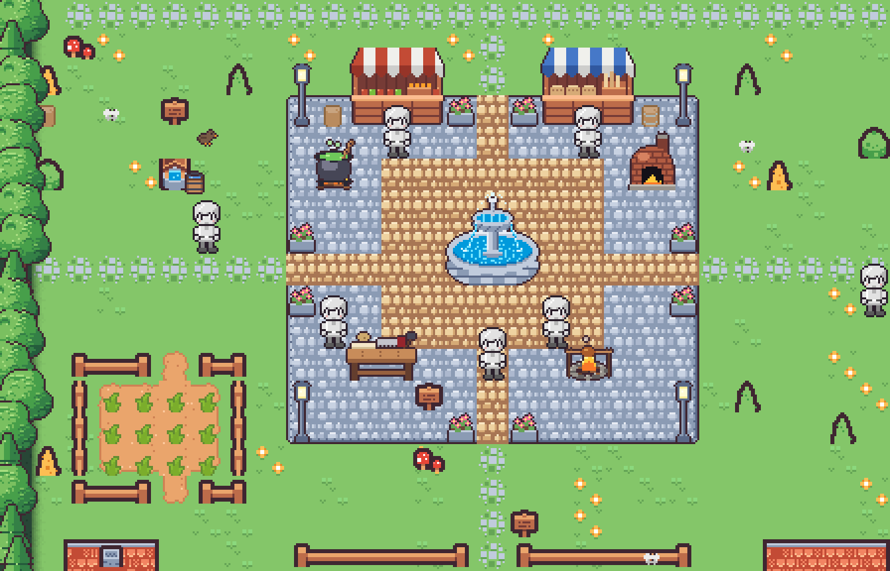

> Một chiến binh thức tỉnh giữa thế giới bị các thế lực cổ đại xâm chiếm. Bắt đầu tay trắng ở Làng Khởi Nguyên,
> bạn đánh quái, hái lượm, chế tạo đồ, lên cấp, hạ Boss canh giữ cửa hang và tiến xuống Hầm Ngục Cổ.

| | |
|---|---|
| **Tên game** | Fantasy: The Awakening (Thức Tỉnh) |
| **Thể loại** | Nhập vai hành động (Action RPG) 2D, góc nhìn từ trên xuống |
| **Đồ họa** | Pixel art 16x16, phong cách đồng quê, rừng rậm, hầm ngục |
| **Điều khiển** | Chuột kiểu Liên Minh Huyền Thoại / Dota (chuột phải để đi và đánh) |
| **Làm bằng** | Godot 4.7 (GDScript) |
| **Trạng thái** | Bản chơi thử (demo) |

> Ghi chú: các ảnh trong tài liệu này được vẽ lại từ bản đồ và hình ảnh thật của game, nên rất giống lúc chơi
> (dân làng trong ảnh vẽ đơn giản hơn, trong game mỗi người một vẻ).

---

## 1. Game thuộc thể loại gì?

**Fantasy: The Awakening** là game **nhập vai hành động** (Action RPG): bạn điều khiển trực tiếp một nhân vật,
đánh quái theo thời gian thực (không phải đánh theo lượt), nhặt kinh nghiệm để lên cấp và mạnh dần lên.

Game trộn thêm vài thứ:

- **Điều khiển kiểu MOBA** (Liên Minh Huyền Thoại, Dota): chuột phải để đi, chuột phải vào quái để tự đánh, Q W E R để tung chiêu.
- **Sinh tồn nhẹ nhàng**: hái quả, săn thú, lấy nước, rồi đem về các trạm để nấu ăn, luyện thuốc, làm công cụ.
- **Khám phá**: 3 ngôi làng, 3 khu rừng, một đấu trường đá cổ và một hầm ngục tối.

---

## 2. Nhân vật và vũ khí

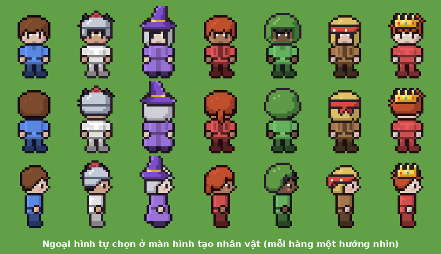

Vào game là tới **màn hình tạo nhân vật**: đặt tên, chọn **ngoại hình** (màu da, kiểu tóc, màu tóc, trang phục, màu áo, mũ)
và chọn **1 trong 4 vũ khí**. Vũ khí gắn với nhân vật luôn, **không đổi được khi đang chơi**, nên hãy chọn kỹ nha.
Ngoại hình thì không phụ thuộc vũ khí: bạn muốn mặc gì cũng được.

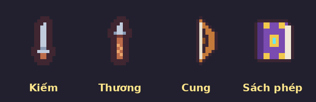

| Vũ khí | Lớp nhân vật | Lối chơi |
|---|---|---|
| **Kiếm** | Kiếm Sĩ | Đánh rất nhanh, bấm liên tục ra combo 3 đòn. Giáp của quái chặn bớt sát thương. |
| **Thương** | Thương Thủ | Đâm xa, chậm hơn, nhưng **xuyên giáp** và **phá giáp** quái. |
| **Cung** | Xạ Thủ | Bắn từ xa. Giữ nút đánh để gồng, thả ra bắn mũi tên đau gấp 3, xuyên qua 2 quái. |
| **Sách Phép** | Pháp Sư | Sách bay cạnh người, bắn tia phép. Sức mạnh nguyên tố sẽ thức tỉnh ở bản sau. |

### Kỹ năng (Q, W, E là chiêu thường, R là tuyệt chiêu, mở dần ở cấp 5, 10, 15, 20)

| Vũ khí | Q | W | E | R |
|---|---|---|---|---|
| **Kiếm** | Triple Slash: chém 3 nhát vòng cung | Piercing Thrust: lao tới đâm xuyên | Whirlwind Slash: xoay chém 360° | Swordstorm: 7 nhát chém siêu nhanh + nhát kết diện rộng |
| **Cung** | Double Shot: bắn nhanh 2 mũi tên | Piercing Arrow: mũi tên xuyên hàng quái | Backstep Shot: lùi lại và bắn 3 mũi tên | Rain of Arrows: mưa tên xuống một vùng |
| **Thương** | Spear Thrust: đâm cực nhanh theo đường thẳng | Sweeping Strike: quét ngang trúng nhiều quái | Impaling Charge: lao tới đâm, đẩy lùi và làm choáng | Heaven's Spear: nhảy lên giáng thương xuống đất |
| **Sách Phép** | Cầu Phép | Vòng Phép | Dịch Chuyển | Thiên Thạch |

Giữ phím kỹ năng để xem tầm và vùng trúng chiêu, thả phím ra là tung chiêu về phía con trỏ chuột.
Mở hết 4 kỹ năng (cấp 20) thì bấm **K** để đổi thứ tự kỹ năng theo ý mình, ví dụ đưa tuyệt chiêu sang phím Q.

---

## 3. Cách chơi

### Điều khiển

| Muốn làm gì | Bấm |
|---|---|
| Đi tới chỗ nào đó (tự tìm đường vòng qua cây, nhà) | **Chuột phải** xuống đất (giữ để đi theo chuột) |
| Đánh một con quái (tự chạy tới và đánh tới khi nó gục) | **Chuột phải** vào con quái |
| Đánh về phía con trỏ (Cung: giữ để gồng, thả để bắn) | **Chuột trái** |
| Vừa đi vừa đánh quái gặp trên đường | **A** rồi chuột trái |
| Đứng lại | **S** |
| Kỹ năng 1, 2, 3 (mở ở cấp 5, 10, 15) | **Q, W, E** |
| Tuyệt chiêu (mở ở cấp 20) | **R** |
| Hủy chiêu đang ngắm | Chuột phải |
| Lướt né (không bị trúng đòn lúc lướt) | **F** |
| Uống bình máu nhanh (mở ở cấp 30) | **D** |
| Mở / đóng túi đồ (bấm vào bình máu để uống) | **B** |
| Bảng kỹ năng, đổi thứ tự kỹ năng | **K** |
| Đi tới chỗ bấm trên bản đồ nhỏ (vòng tròn góc trên bên trái) | **Chuột phải** lên bản đồ nhỏ |
| Mở / đóng bản đồ lớn | **M** |
| Tạm dừng, xem danh sách kỹ năng | **Esc** |
| Tạo nhân vật mới (lúc tạm dừng, thua hoặc thắng) | **N** |

### Bản đồ nhỏ

Giống Liên Minh Huyền Thoại: góc trên bên trái có **bản đồ nhỏ hình tròn**, bạn luôn ở giữa vòng tròn.
Bấm chuột phải vào chỗ nào trên bản đồ là nhân vật tự tìm đường đi tới đó, có đường xanh chỉ lối. Bấm **M** để mở bản đồ lớn có tên các khu.
Chấm trắng là bạn, chấm đỏ là quái, chấm đỏ to là Boss, ô cam là trạm chế tạo, chấm tím là cửa hang.

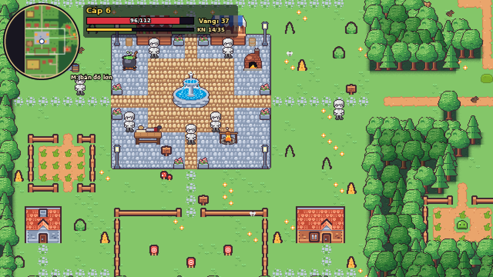

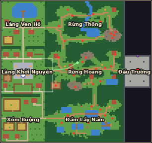

### Đánh quái

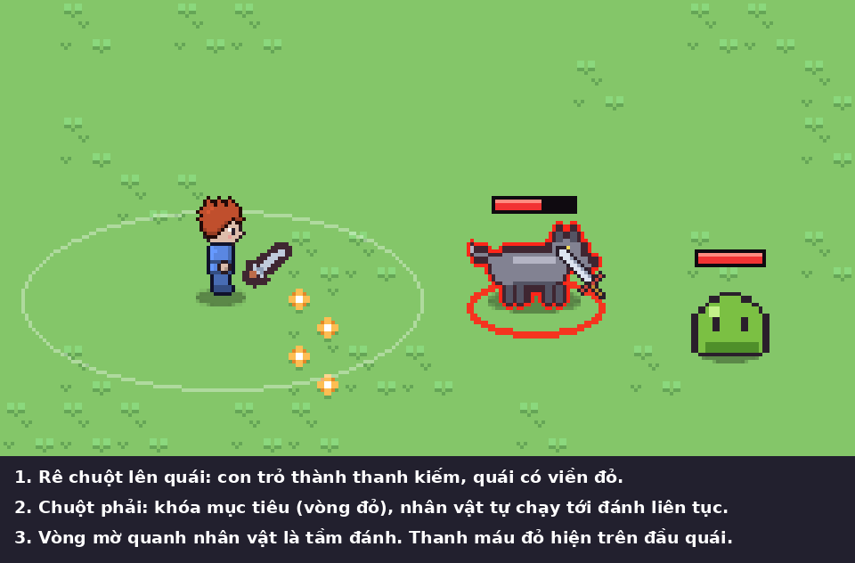

- Rê chuột lên quái: con trỏ đổi thành **thanh kiếm**, quái có **viền đỏ**.
- Bấm **chuột phải** vào quái: khóa mục tiêu (vòng đỏ dưới chân), nhân vật tự chạy tới đánh liên tục.
- Quái có **giáp** (hình khiên trên đầu) bị trừ bớt sát thương mỗi đòn. Thương phá được giáp.
- Đánh trúng có rung màn hình, khựng hình, quái nháy trắng cho đã tay.
- Hạ quái rơi **ngọc xanh** (kinh nghiệm), bình máu, vàng, pha lê tím (+tấn công). Đủ kinh nghiệm là **lên cấp**.

### Lên cấp và mở khóa kỹ năng

Mới vào game bạn chỉ có **đánh thường** và **lướt (F)**. Đánh quái để lên cấp, cứ 5 cấp lại mở thêm một kỹ năng:

| Cấp | Mở khóa |
|---|---|
| 5 | Kỹ năng **Q** |
| 10 | Kỹ năng **W** |
| 15 | Kỹ năng **E** |
| 20 | Tuyệt chiêu **R**, và được đổi thứ tự kỹ năng (phím K) |
| 30 | Phím **D** uống bình máu nhanh |

Mỗi cấp được thêm 8 máu tối đa và 1 tấn công. Ô kỹ năng chưa mở có màu tối và ghi cấp cần đạt.

### Quái vật

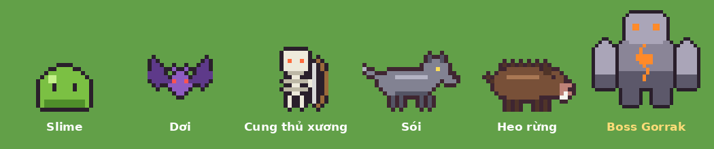

| Quái | Ở đâu | Cách nó đánh |
|---|---|---|
| **Slime** | Các khu rừng, đầm lầy, hầm ngục | Nhảy từng nhịp về phía bạn. |
| **Dơi** | Rừng Hoang, Đầm Lầy Nấm, hầm ngục | Bay nhanh, lượn zic-zắc khi lao vào. |
| **Cung thủ xương** | Rừng Hoang, hầm ngục | Giữ khoảng cách và bắn tên. Có 3 giáp. |
| **Sói** | Rừng Thông | Chạy rất nhanh, hay đi theo bầy, tới gần thì vồ. Rơi da, thịt, xương. |
| **Heo rừng** | Rừng Thông, Đầm Lầy Nấm | Cào chân lấy đà rồi húc thẳng rất mạnh: né sang bên! Rơi da, thịt, xương. |
| **Boss Gorrak** (Thạch Vương Cổ Đại) | Đấu Trường Đá Cổ | 5 giáp. Nhảy đập (né vòng đỏ!), bắn cầu bóng tối tỏa tròn, dưới nửa máu thì gọi thêm slime. |

Quái thường (trừ Boss) hạ xong sẽ quay lại sau 2 phút, nên cứ đánh tiếp để luyện cấp. Quái trong hầm ngục cho nhiều kinh nghiệm hơn.

### Mục tiêu bản chơi thử

1. **Làng Khởi Nguyên**: bắt đầu ở quảng trường. Nói chuyện với dân làng, đọc biển báo, ra **bãi tập** đánh bù nhìn cho quen tay (lúc này mới có đánh thường và lướt).
2. **Hái lượm và chế tạo**: hái quả, thảo dược, săn sói và heo rừng, về quảng trường nấu ăn, luyện thuốc, làm rìu, ba lô, áo giáp.
3. **Rừng Hoang** (phía đông làng): đánh slime, dơi, cung thủ xương để lên cấp và mở kỹ năng Q, W, E.
4. **Đấu Trường Đá Cổ**: hạ Boss **Gorrak**. Phong ấn ở cửa hang sau lưng Boss sẽ vỡ ra.
5. **Hầm Ngục Cổ**: đi vào hang, vượt qua hầm ngục tối và bước vào **Cổng Xoáy** ở phòng cuối để chiến thắng.

---

## 4. Thế giới

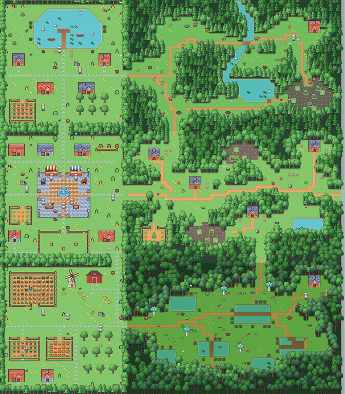

Bản đồ có 3 dải nối liền nhau. Đi qua mép khu nào là hiện tên khu đó.

**Dải trên: Làng Ven Hồ và Rừng Thông**. Làng chài bên hồ lớn có cầu tàu, thuyền, vịt, vườn cà rốt, vườn táo.
Rừng Thông có suối, cầu gỗ, nai, thỏ, quả mọng, thảo dược, bầy sói và heo rừng.

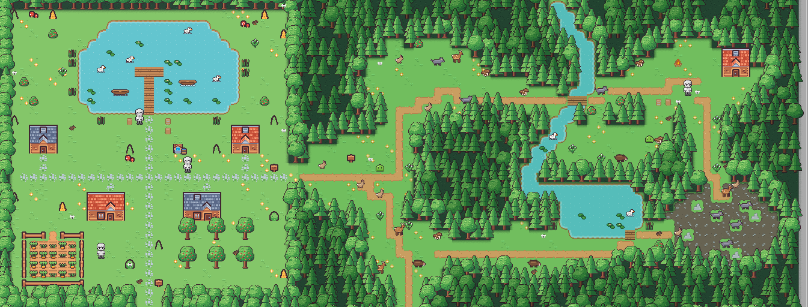

**Dải giữa: Làng Khởi Nguyên và Rừng Hoang**. Làng Khởi Nguyên là nơi bắt đầu game, có quảng trường đài phun nước,
sạp hàng, dân làng, bãi tập. Rừng Hoang phía đông có nhiều bãi cỏ, nhà gỗ, bãi đá, hồ có thác nước và lũ quái đầu tiên.

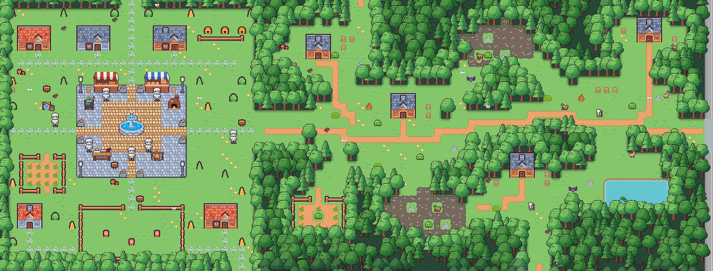

**Dải dưới: Xóm Ruộng và Đầm Lầy Nấm**. Ruộng lúa, cối xay gió, nhà kho, bí ngô. Đầm lầy có ao, nấm khổng lồ,
ếch, đom đóm, slime và heo rừng.

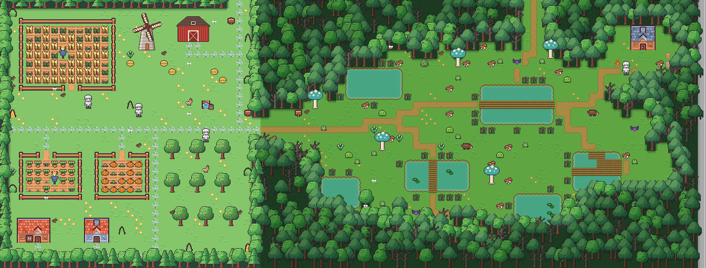

Thú hiền (thỏ, nai, chim, bướm, ếch, vịt) đi lại, ăn cỏ, thấy bạn tới gần thì bỏ chạy. Chúng không đánh được, chỉ cho thế giới thêm sống động.

### Đấu Trường Đá Cổ và cửa hang

Đi hết Rừng Hoang về phía đông là tới đấu trường của Boss. **Cửa hang** nằm ở vách phía bắc, ngay sau lưng Boss,
bị **phong ấn tím** chặn lại. Hạ Boss xong phong ấn vỡ ra, đi vào hang là xuống Hầm Ngục Cổ.

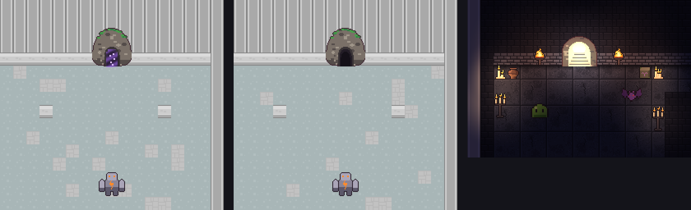

### Hầm Ngục Cổ

Hầm ngục tối om, chỉ có nến, đuốc trên tường, bệ thờ phát sáng và một vòng sáng nhỏ quanh người bạn
(có **Đuốc** trong túi thì vòng sáng to hơn). Quái ở đây mạnh hơn. Cổng Xoáy tím ở phòng cuối là đích đến.
Muốn quay ra thì đi vào **cầu thang sáng** ngay chỗ bạn vừa xuống.

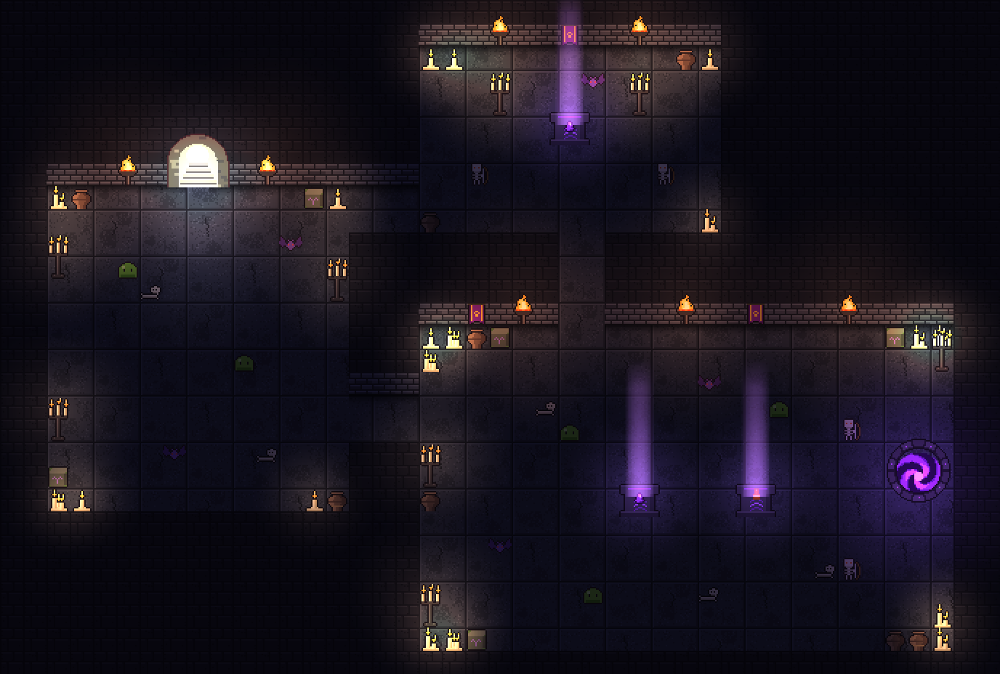

---

## 5. Hái lượm và chế tạo

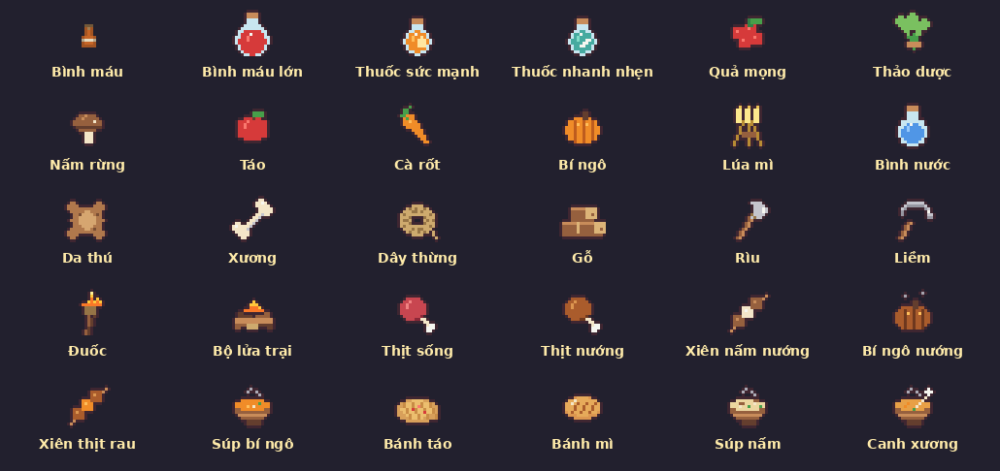

**Hái lượm**: đi tới gần cây đã chín (hoặc chuột phải vào cây) là tự hái. Hái xong cây tự mọc lại sau một lúc.
Có quả mọng, thảo dược, nấm, lúa mì, cà rốt, bí ngô, táo. **Nước** lấy ở xô cạnh giếng (làng nào cũng có giếng).
**Gỗ** chặt ở các gốc cây trong rừng (cần có Rìu). Sói và heo rừng cho **da thú, thịt, xương**.

**Túi đồ** (phím B): 12 ô, làm ba lô để lên 16 rồi 20 ô. Bấm vào món ăn để ăn, bấm vào thuốc để uống.
**Công cụ** (rìu, liềm, đuốc) chỉ cần nằm trong túi là có tác dụng.

### 4 trạm chế tạo ở quảng trường

Bốn góc quảng trường Làng Khởi Nguyên là 4 trạm. Đi tới gần trạm nào thì bảng chế tạo của trạm đó tự mở,
đủ nguyên liệu (chữ xanh) thì bấm **Chế**.

| Trạm | Vị trí | Làm ra |
|---|---|---|
| **Nồi luyện thuốc** | Góc trên trái | Bình máu, Bình máu lớn, Thuốc sức mạnh, Thuốc nhanh nhẹn |
| **Lò nấu ăn** (lò gạch) | Góc trên phải | Bánh mì, Bánh táo, Súp nấm, Súp bí ngô, Canh xương |
| **Bàn chế tạo** | Góc dưới trái | Dây thừng, Rìu, Liềm, Đuốc, Bộ lửa trại, Ba lô lớn hơn, Áo giáp da, Bùa răng sói |
| **Bếp lửa** | Góc dưới phải | Thịt nướng, Xiên nấm nướng, Bí ngô nướng, Xiên thịt rau |

Lửa trại trong rừng cũng nướng đồ được như bếp lửa. Có **Bộ lửa trại** thì bấm vào nó trong túi để tự đặt một bếp lửa ở đâu cũng được.

### Công thức

| Trạm | Món | Nguyên liệu | Tác dụng |
|---|---|---|---|
| Nồi luyện thuốc | Bình máu | 2 thảo dược + 1 bình nước | Hồi 40% máu |
| Nồi luyện thuốc | Bình máu lớn | 3 thảo dược + 1 táo + 1 bình nước | Hồi 80% máu |
| Nồi luyện thuốc | Thuốc sức mạnh | 1 thảo dược + 2 xương + 1 bình nước | Tấn công +6 trong 60 giây |
| Nồi luyện thuốc | Thuốc nhanh nhẹn | 2 quả mọng + 1 thảo dược + 1 bình nước | Tốc độ +30% trong 60 giây |
| Bếp lửa | Thịt nướng | 1 thịt sống | Hồi 35 máu |
| Bếp lửa | Xiên nấm nướng | 3 nấm | Hồi 25 máu |
| Bếp lửa | Bí ngô nướng | 1 bí ngô | Hồi 50 máu |
| Bếp lửa | Xiên thịt rau | 1 thịt + 1 cà rốt + 1 nấm | Hồi 60 máu |
| Lò nấu ăn | Bánh mì | 2 lúa mì + 1 bình nước | Hồi 25 máu |
| Lò nấu ăn | Bánh táo | 2 táo + 2 lúa mì | Hồi 45 máu |
| Lò nấu ăn | Súp nấm | 2 nấm + 2 quả mọng | Hồi 5 máu mỗi giây trong 10 giây |
| Lò nấu ăn | Súp bí ngô | 1 bí ngô + 1 cà rốt + 1 bình nước | Hồi 8 máu mỗi giây trong 12 giây |
| Lò nấu ăn | Canh xương | 2 xương + 1 cà rốt + 1 bình nước | Hồi 6 máu mỗi giây trong 15 giây |
| Bàn chế tạo | Dây thừng | 3 lúa mì | Nguyên liệu |
| Bàn chế tạo | Rìu | 2 xương + 1 dây thừng | Chặt gốc cây lấy gỗ |
| Bàn chế tạo | Liềm | 1 xương + 1 gỗ + 1 dây thừng | Hái cây được thêm 1 |
| Bàn chế tạo | Đuốc | 1 gỗ + 1 dây thừng | Vòng sáng to hơn trong hầm ngục |
| Bàn chế tạo | Bộ lửa trại | 3 gỗ + 1 dây thừng | Đặt bếp lửa ở đâu cũng được |
| Bàn chế tạo | Ba lô lớn hơn | 3 da thú + 2 dây thừng | Túi thêm 4 ô (làm được 2 lần) |
| Bàn chế tạo | Áo giáp da | 4 da thú + 1 dây thừng | Máu tối đa +25 |
| Bàn chế tạo | Bùa răng sói | 4 xương + 1 da thú + 1 dây thừng | Tấn công +4 |

Mẹo: làm **Rìu** trước (chỉ cần xương và dây thừng), có rìu mới chặt được gỗ để làm liềm, đuốc và bộ lửa trại.

---

## 6. Đồ họa

- Phong cách **pixel art 16x16**, màu tươi sáng ở làng và rừng, tối và lung linh ánh nến ở hầm ngục.
- Ánh sáng trong hầm ngục dùng đèn 2D của Godot: chỗ nào có nến, đuốc, bệ thờ thì sáng, còn lại tối.
- Nhân vật chính, quái vật, thú hiền, cây trồng, trạm chế tạo, cửa hang, hầm ngục, vật phẩm: **Claude vẽ** riêng cho game.
- Nhà cửa, cỏ, nước, tường, kiếm: lấy từ bộ hình **Kenney** (Tiny Town, Roguelike RPG, Tiny Dungeon,
  www.kenney.nl, giấy phép CC0, dùng tự do kể cả thương mại).

---

## 7. Sắp tới

- Thức tỉnh **nguyên tố** Lửa và Sấm, gắn kỹ năng nguyên tố vào ô Q W E R.
- Bộ kỹ năng riêng cho **Sách Phép**.
- Mua bán ở các sạp hàng trong làng.
- Lưu túi đồ và trang bị giữa các lần chơi.

---

Cách mở game, cách sửa bản đồ, công thức, kỹ năng... xem file `README.md` ở thư mục gốc của game.
